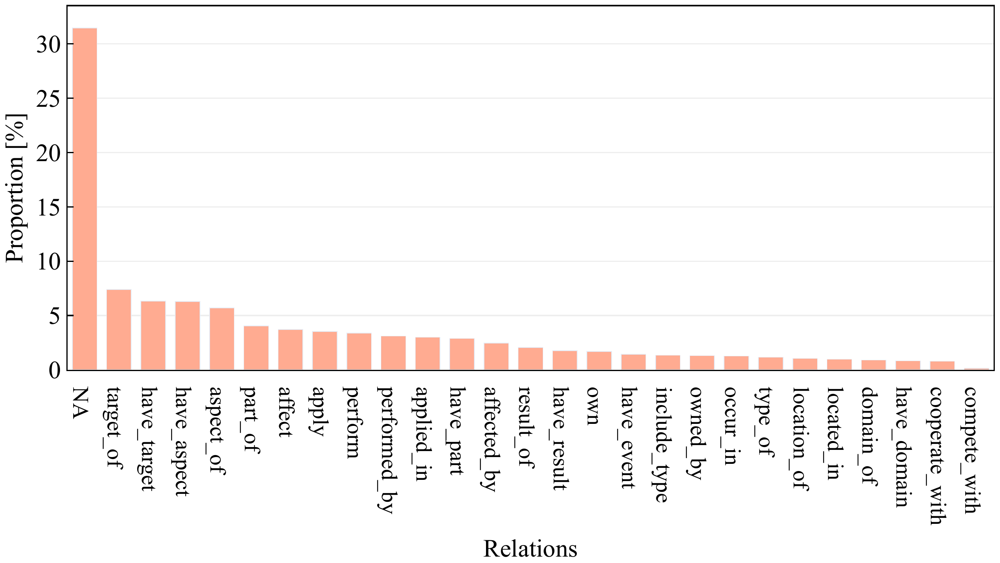

# AerospaceRE

**中文** | [English](#english)

AerospaceRE 是一个**中文航空航天领域低资源关系抽取**评测数据集，由北京航空航天大学软件开发环境国家重点实验室（SKLSDE, Beihang University）发布。数据集基于 [Chu et al. (2024)](https://doi.org/10.1038/s41598-023-50705-0) 的航空航天命名实体识别数据（数据仓库：[Aerospace_NERdatasets](https://github.com/Coder-XIAOKAI/Aerospace_NERdatasets)）重新标注与重新划分构建，面向少样本（few-shot）关系抽取评测。

- 数据集地址：<https://github.com/liuxiyang641/AerospaceRE>
- 标注平台：[Label Studio](https://labelstud.io/)

---

## 中文

### 1. 数据集简介

数据集以**航空航天装备**为核心，覆盖 **7 类实体**：航空航天技术设备（`ATAE`）、航空航天飞行器（`TOAV`）、星座与卫星（`CAS`）、空间任务与项目（含事件与活动，`SMAP`）、航空航天公司与机构（`ACAO`）、机场与航天发射场（`AASLS`）、科学家与宇航员（`SAA`）。

关系标注共 **27 个标签**：26 种正向关系 + `NA`（无关系），其中包含 12 组正反向关系对（如 `part_of` / `have_part`）与 2 种对称关系（`cooperate_with`、`compete_with`）。

数据来源于学术论文、技术说明与新闻报道等公开渠道，不含企业保密信息。标注由三位具备关系抽取任务背景知识的研究生共同完成，不一致样本以多数投票确定最终标签。

### 2. 数据统计

每条实例由「一个句子 + 一个 `(头实体 h, 尾实体 t, 关系 r)` 三元组」构成，同一句子可对应多条实例。

| 划分 | 实例数 | 文件 |
| --- | ---: | --- |
| 训练集 | 619 | `train.json` |
| 验证集 | 585 | `val.json` |
| 测试集 | 1,464 | `test.json` |
| 合计 | 2,668 | — |

关系标注示例（方向为 `h → t`）：「飞艇 —have_part→ 电传操纵系统」、「卫星 —target_of→ 发射」、「钛合金 —applied_in→ 零件」。各关系类型在整个数据集中的占比见图 1。

<p align="center">
  
</p>

图 1：各关系类型在数据集中的占比（%，含 `NA`）。


### 3. 文件说明

| 文件 | 说明 |
| --- | --- |
| `train.json` / `val.json` / `test.json` | 训练 / 验证 / 测试集关系标注（JSON Lines） |
| `rel2id.json` | 关系标签到 id（0–26）的映射 |
| `data_trans.ipynb` | 少样本子集生成脚本 |
| `figures/aerospacere_relation_distribution.png` | 关系类型分布图 |
| `aeroner.train` / `aeroner.dev` / `aeroner.test` | 原始 NER 数据（字符级 BMESO 标注） |

### 4. 数据格式

`train.json` 等为 UTF-8 编码的 JSON Lines 文件，每行一个实例：

```json
{"token": ["国", "内", "首", "套", "载", "人", "飞", "艇", "电", "传", "操", "纵", "系", "统", "研", "制", "成", "功", "@", "日", "前", "。"], "h": {"name": "飞艇", "pos": [6, 8], "type": "Type of aerospace vehicle (TOAV)"}, "t": {"name": "电传操纵系统", "pos": [8, 14], "type": "Aerospace technology and equipment (ATAE)"}, "relation": "have_part"}
```

- `token`：字符级 token 序列，`"".join(token)` 即原句；
- `h` / `t`：头 / 尾实体，`name` 为实体文本，`pos` 为 `[start, end)` 的 token 下标（左闭右开），`type` 为实体类型；
- `relation`：关系标签（`rel2id.json` 的键，`NA` 表示无关系），方向为 `h → t`。

`aeroner.*` 为 CoNLL 风格的字符级序列标注文件，每行 `字符 标签`（如 `高 B-ATAE`），空行分隔句子。

### 5. 少样本划分

[`data_trans.ipynb`](./data_trans.ipynb) 按关系类型分层采样生成少样本子集，结果输出至 `k-shot/{k}-{split_id}/` 目录：

| 输出文件 | 划分结果 |
| --- | --- |
| `k-shot/{k}-{split_id}/train.json` | 每类关系从训练集中随机采样 $k$ 条（不足 $k$ 条则取该类全部） |
| `k-shot/{k}-{split_id}/val.json` | 每类关系从验证集中随机采样 $k$ 条（同上） |
| `k-shot/{k}-{split_id}/test.json` | 完整测试集，直接复制 |

默认 `k = 8`、随机种子固定为 42；建议使用不同 `split_id`（如 1–5）重复采样，报告多次结果的平均值与方差。

### 6. 引用

如使用本数据集，请引用原始 NER 数据集，并注明本仓库：

```bibtex
@Article{Chu2024,
  author  = {Chu, Jing and Liu, Yumeng and Yue, Qi and Zheng, Zixuan and Han, Xiaokai},
  title   = {Named entity recognition in aerospace based on multi-feature fusion transformer},
  journal = {Scientific Reports},
  year    = {2024},
  month   = {Jan},
  day     = {08},
  volume  = {14},
  number  = {1},
  pages   = {1--14},
  issn    = {2045-2322},
  doi     = {10.1038/s41598-023-50705-0},
  url     = {https://doi.org/10.1038/s41598-023-50705-0}
}

@misc{AerospaceRE,
  author       = {{AerospaceRE Contributors}},
  title        = {{AerospaceRE}: A Chinese Low-Resource Relation Extraction Benchmark in the Aerospace Domain},
  organization = {SKLSDE, Beihang University},
  howpublished = {\url{https://github.com/liuxiyang641/AerospaceRE}},
  note         = {Re-annotated and re-split from Chu et al. (2024)}
}
```

---

## English

### 1. Overview

AerospaceRE is a **Chinese low-resource relation extraction benchmark in the aerospace domain**, released by the State Key Laboratory of Software Development Environment (SKLSDE), Beihang University. It is re-annotated and re-split from the aerospace named entity recognition corpus of [Chu et al. (2024)](https://doi.org/10.1038/s41598-023-50705-0) (data repository: [Aerospace_NERdatasets](https://github.com/Coder-XIAOKAI/Aerospace_NERdatasets)), and targets few-shot relation extraction evaluation.

The corpus is centered on **aerospace equipment** and covers **7 entity types**: aerospace technology and equipment (`ATAE`), aerospace vehicles (`TOAV`), constellations and satellites (`CAS`), space missions and projects including events and activities (`SMAP`), aerospace companies and organizations (`ACAO`), airports and spacecraft launch sites (`AASLS`), and scientists and astronauts (`SAA`).

**27 relation labels** are provided: 26 positive relations plus `NA`, comprising 12 inverse pairs (e.g. `part_of` / `have_part`) and 2 symmetric relations (`cooperate_with`, `compete_with`).

Data are collected from publicly available academic papers, technical reports and news, and contain no confidential enterprise information. Annotation was carried out by three graduate students with a background in relation extraction, with disagreements resolved by majority voting.

### 2. Statistics

Each instance consists of a sentence together with one `(head entity h, tail entity t, relation r)` triple; a sentence may contribute several instances.

| Split | Instances | File |
| --- | ---: | --- |
| Train | 619 | `train.json` |
| Dev | 585 | `val.json` |
| Test | 1,464 | `test.json` |
| Total | 2,668 | — |

The proportion of each relation type over the whole corpus is shown in Figure 1.

<p align="center">
  
</p>

Figure 1: Proportion (%) of each relation type in AerospaceRE (including `NA`).


### 3. Repository Structure

| File | Description |
| --- | --- |
| `train.json` / `val.json` / `test.json` | Relation annotations for train / dev / test (JSON Lines) |
| `rel2id.json` | Relation label → id (0–26) mapping |
| `data_trans.ipynb` | Few-shot subset generation script |
| `figures/aerospacere_relation_distribution.png` | Relation distribution figure |
| `aeroner.train` / `aeroner.dev` / `aeroner.test` | Original NER data (character-level BMESO tagging) |

### 4. Data Format

`train.json` and the other splits are UTF-8 **JSON Lines** files, one instance per line:

```json
{"token": ["国", "内", "首", "套", "载", "人", "飞", "艇", "电", "传", "操", "纵", "系", "统", "研", "制", "成", "功", "@", "日", "前", "。"], "h": {"name": "飞艇", "pos": [6, 8], "type": "Type of aerospace vehicle (TOAV)"}, "t": {"name": "电传操纵系统", "pos": [8, 14], "type": "Aerospace technology and equipment (ATAE)"}, "relation": "have_part"}
```

- `token`: character-level tokens; `"".join(token)` restores the sentence;
- `h` / `t`: head / tail entity, with `name` (surface form), `pos` (`[start, end)` token indices, end exclusive) and `type` (entity label);
- `relation`: relation label (a key of `rel2id.json`; `NA` means no relation), directed from `h` to `t`.

`aeroner.*` are CoNLL-style character-level tagging files: one `char TAG` pair per line (e.g. `高 B-ATAE`), with blank lines separating sentences.

### 5. Few-shot Splits

[`data_trans.ipynb`](./data_trans.ipynb) generates relation-stratified few-shot subsets under `k-shot/{k}-{split_id}/`:

| Output | Split result |
| --- | --- |
| `k-shot/{k}-{split_id}/train.json` | $k$ random samples per relation drawn from the training split (all samples if fewer than $k$) |
| `k-shot/{k}-{split_id}/val.json` | $k$ random samples per relation drawn from the dev split (same rule) |
| `k-shot/{k}-{split_id}/test.json` | the full test split, copied as-is |

The default setting is `k = 8` with a fixed seed of 42; using different `split_id` values (e.g. 1–5) is recommended, with mean and variance reported over runs.

### 6. Citation

If you use AerospaceRE, please cite the original NER dataset and refer to this repository:

```bibtex
@Article{Chu2024,
  author  = {Chu, Jing and Liu, Yumeng and Yue, Qi and Zheng, Zixuan and Han, Xiaokai},
  title   = {Named entity recognition in aerospace based on multi-feature fusion transformer},
  journal = {Scientific Reports},
  year    = {2024},
  month   = {Jan},
  day     = {08},
  volume  = {14},
  number  = {1},
  pages   = {1--14},
  issn    = {2045-2322},
  doi     = {10.1038/s41598-023-50705-0},
  url     = {https://doi.org/10.1038/s41598-023-50705-0}
}

@misc{AerospaceRE,
  author       = {{AerospaceRE Contributors}},
  title        = {{AerospaceRE}: A Chinese Low-Resource Relation Extraction Benchmark in the Aerospace Domain},
  organization = {SKLSDE, Beihang University},
  howpublished = {\url{https://github.com/liuxiyang641/AerospaceRE}},
}
```
